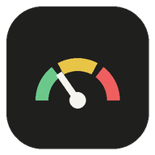
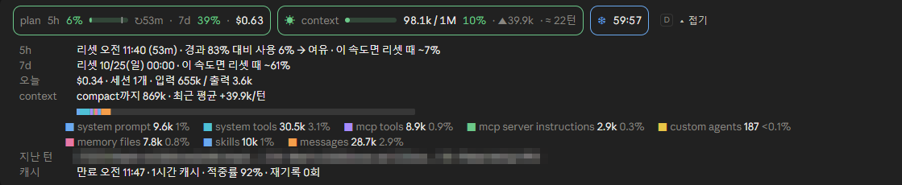
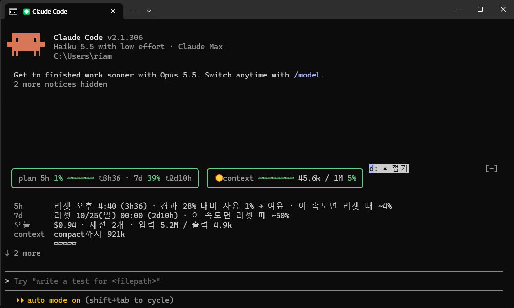
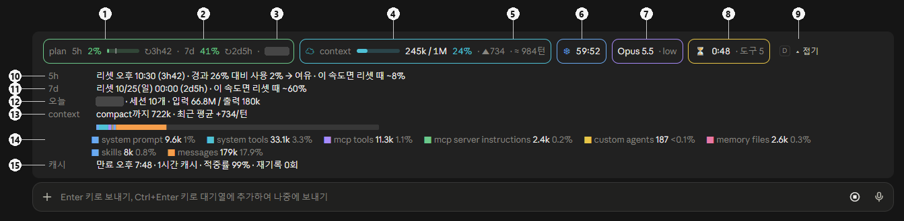
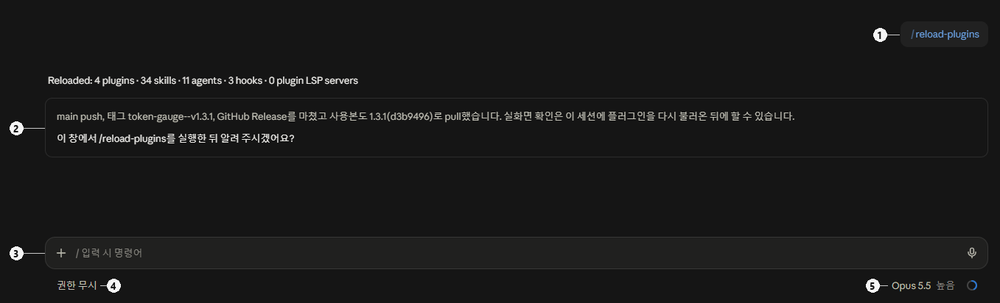
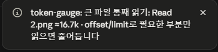

<p align="center"></p>

<h1 align="center">token-gauge</h1>

<p align="center"><b>Claude Code 입력창 위에 사용량 한도, 컨텍스트, 캐시 남은 시간을 늘 띄워 둡니다.</b><br>색으로 상태를 알려 주는 칩과 모델 칩, 펼치면 보이는 상세 패널, 토큰을 아끼는 버튼과 팁까지.</p>

<p align="center">
  <a href="CHANGELOG.md"></a>
  <a href="https://github.com/riam-park/token-gauge/actions/workflows/ci.yml"></a>
  
  <a href="LICENSE"></a>
</p>

<p align="center">
  <a href="#-설치">설치</a> · <a href="#-무엇을-보여-주나요">기능</a> · <a href="#%EF%B8%8F-설치할-때-묻는-설정">설정</a> · <a href="docs/TOKEN_TIPS.md">토큰 절약 가이드</a> · <a href="CHANGELOG.md">변경 기록</a>
</p>

<table>
  <tr>
    <td align="center" width="50%"><br>🟢 <b>칩 줄</b><br>한도, 컨텍스트, 캐시를 한 줄로</td>
    <td align="center" width="50%"><br>🔎 <b>상세 패널</b><br>리셋 예측, 오늘 합계, 범주별 막대</td>
  </tr>
  <tr>
    <td align="center" colspan="2"><br>⌨️ <b>터미널(CLI)</b><br>막대는 ▰▱ 문자로, 상세는 같은 내용으로</td>
  </tr>
</table>

<sub>모두 Windows 11에서 찍은 실제 화면입니다. 데스크톱 앱 Code 탭은 Claude Code 2.1.304, 터미널은 2.1.306입니다. 상세 패널의 "지난 턴" 줄은 개인 경로라 가렸습니다.</sub>

## 🚀 설치

**가장 쉬운 방법**: Claude Code에 이 문장을 그대로 보내세요. Claude가 버전 확인, 설정 질문, 설치까지 진행합니다.

```text
https://github.com/riam-park/token-gauge 를 내 클로드에 반영해줘.
```

**직접 설치**: Claude Code 입력창(데스크톱 앱이나 터미널)에 한 줄씩 입력합니다.

```text
/plugin marketplace add https://github.com/riam-park/token-gauge.git
```

```text
/plugin install token-gauge@token-gauge
```

설정 창이 뜨면 [설정](#%EF%B8%8F-설치할-때-묻는-설정)을 고릅니다(그냥 넘어가면 기본값). 그다음 `/reload-plugins`를 입력하거나 새 세션을 엽니다. 메시지를 한 번 주고받으면 칩이 다 채워집니다.

<details>
<summary><b>설치 전에 버전 확인하기</b></summary>

mod는 Claude Code **2.1.287 이상**에서 동작합니다.

- **데스크톱 앱(Code 탭)**: 입력창에 `/status`를 입력하고 **Claude Code** 줄을 봅니다. 낮으면 앱을 업데이트합니다.
- **터미널**: 아래 명령으로 확인하고, 낮으면 `claude update`를 실행합니다.

```bash
claude --version
```

</details>

<details>
<summary><b>자동 업데이트 켜기 (권장)</b></summary>

`/plugin` → **Marketplaces** 탭 → **token-gauge** → **Enable auto-update**

직접 받으려면:

```bash
claude plugin marketplace update token-gauge
```

```bash
claude plugin update token-gauge@token-gauge
```

</details>

## 👀 무엇을 보여 주나요



**칩 줄**

| 번호 | 항목         | 담고 있는 것                                                   |
|------|--------------|----------------------------------------------------------------|
| 1    | 5h 한도      | 5시간 한도 사용률, 막대의 회색 눈금(지난 시간), `↻` 리셋까지   |
| 2    | 7d 한도      | 주간 한도 사용률과 리셋까지 남은 시간. plan 칩 테두리 색 기준  |
| 3    | 비용         | 이 세션 비용(구독자는 정가 기준 추정)                          |
| 4    | context      | 날씨 아이콘과 색(compact 기준선 대비), 사용량 / 창 크기, 비율  |
| 5    | 증가·남은 턴 | `▲` 지난 턴 증가량, `≈` 이 속도로 compact까지 남은 턴          |
| 6    | ❄ 캐시       | 프롬프트 캐시가 식기까지 남은 시간                             |
| 7    | 모델         | 지금 모델과 effort. 테두리 색은 모델 계열                      |
| 8    | ⏳ 작업 중   | Claude가 일하는 동안 경과 시간, 도구 호출 수, 실행 중 subagent |
| 9    | ▾ 상세       | 상세 패널 열기/접기(칩 줄에 포커스 후 `d`)                     |

**상세 패널** (`▾ 상세`로 열림)

| 번호 | 줄        | 담고 있는 것                                                 |
|------|-----------|--------------------------------------------------------------|
| 10   | 5h        | 리셋 시각, 경과 대비 사용(여유/과속), 이 속도면 리셋 때 예측 |
| 11   | 7d        | 주간 리셋 시각과 리셋 때 예측                                |
| 12   | 오늘      | 이 컴퓨터 모든 세션의 오늘 합계: 비용, 세션 수, 입력/출력    |
| 13   | context   | compact까지 남은 양, 최근 턴 평균 증가량                     |
| 14   | 범주 막대 | `/context` 범주별로 컨텍스트를 채운 양과 비율                |
| 15   | 캐시      | 만료 시각, 캐시 수명(1시간/5분), 적중률, 재기록 횟수         |

데이터가 있을 때만 나오는 상세 줄(지난 턴, 중복, compact)과 버튼(`/compact`, `인계 메모 후 새 세션`, `유지 90분`)은 아래에서 설명합니다. 그림의 비용 숫자는 가렸습니다.

| 칩          | 보여 주는 것                                             | 색                                                       |
|-------------|----------------------------------------------------------|----------------------------------------------------------|
| **plan**    | 5시간·주간 한도 사용량, 리셋까지 남은 시간, 세션 비용    | 주간 사용량 기준 초록 → 노랑(75%) → 빨강(90%)            |
| **context** | 대화 크기(답변 중에도 몇 초마다 갱신), 지난 턴 증가량(`▲`), compact까지 남은 턴(`≈`) | ☀ 초록 ☁ 청록 ☂ 보라 ☇ 주황 ↯ 빨강 (compact 기준선 대비) |
| **❄ 캐시**  | 캐시가 식기까지 남은 시간                                | 파랑 → 노랑(10분 이하) → 빨강 `cold`                     |
| **모델**    | 지금 모델과 effort (`Opus 5.5 · high`)                   | Opus 보라, Sonnet 파랑, Haiku 초록 테두리                |

- **5h 막대의 회색 눈금**: 5시간 중 지난 시간입니다. 채움이 눈금보다 뒤에 있으면 여유, 앞서면 과속입니다.
- **`▾ 상세`**: 누르면 아래 패널이 열립니다.
  - 5h·7d 정확한 리셋 시각과 "이 속도면 리셋 때 ~61%" 예측
  - 오늘 이 컴퓨터의 모든 세션 합계(비용, 세션 수, 토큰)
  - compact까지 남은 양과 무엇이 컨텍스트를 채우는지 범주별 막대
  - 지난 턴에 결과가 가장 컸던 도구 호출 3개. `≈`는 문자 수로 어림한 값이며, 턴 사이 실제 입력 증가량으로 보정한 배율(`추정 ×1.32`)을 곱합니다.
  - 중복: 바뀌지 않은 파일을 같은 범위로 다시 읽은 횟수와 양, 같은 도구가 같은 출력을 다시 낸 횟수와 양
  - compact: 직전 compaction 전후 크기와, 요약에 이름이 빠진 이번 세션 편집 파일
  - 캐시 만료 시각, 적중률, 재기록 횟수
- **버튼**
  - `/compact`, `인계 메모 후 새 세션`: 컨텍스트가 compact 기준선의 70%를 넘으면 나타납니다. 인계 메모는 기본으로 Claude의 답변으로 받습니다. 새 세션에 붙여 넣어 이어 가면 됩니다. compaction 요약에 빠진 편집 파일이 있으면 메모에 넣으라고 함께 요청합니다.
  - `유지 90분`: 캐시가 10분 이하로 남았을 때, [cache-tax](#-선택-캐시-유지-버튼)를 설치한 경우에만 보입니다.
- **작업 중 칩** `⏳ 2:14 · 도구 9 · subagent 2 실행 중`: Claude가 일하는 동안 붙습니다.
- **알림**: 5시간 한도 90%, 컨텍스트 80%, 캐시 만료 5분 전에 한 번씩 알려 줍니다. 새 버전이 나오면 하루 한 번 알려 줍니다.
- **토큰 절약 팁**: 세션마다 종류별로 한 번, 줄일 수 있는 양(`≈`)과 함께 알려 줍니다. 큰 파일 통째 읽기(≈10k 이상), 긴 명령 출력이나 subagent 결과(≈8k 이상), 변경 없는 재읽기 3회, 10턴 동안 쓰지 않은 MCP 서버의 도구(≈5k 이상), 큰 메모리 파일(≈8k 이상)이 대상입니다. `alerts`를 끄면 함께 꺼집니다.
- **질문 카드**: Claude가 선택지를 묻는 동안(AskUserQuestion)에도 질문 위에 칩 줄이 남습니다. 버튼과 상세 패널은 빠지고, 터미널에서는 한 줄 글자로 줄어듭니다.
- **막힌 프롬프트**: 다른 mod의 훅이 보낸 프롬프트를 막으면(예: cache-tax가 식은 캐시의 재기록 비용을 알릴 때) 막혔다는 경고를 띄우기 전에 질문 카드로 그 이유와 함께 `보내기`/`취소`를 묻습니다. `보내기`는 같은 내용을 그대로 보내고, `취소`는 입력창에 되돌립니다. 카드를 닫으면 원래 경고가 나오고 입력창에 되돌립니다.
- **단축키**: 칩 줄을 클릭하거나 `Ctrl+X` `Tab`으로 포커스를 옮긴 뒤 `d`

## 📖 용어

README와 Claude Code 화면에 나오는 말입니다. 공식 이름은 [Claude Code 용어집](https://code.claude.com/docs/en/glossary)과 [데스크톱 문서](https://code.claude.com/docs/en/desktop)를 따릅니다. 공식 문서에 이름이 없는 화면 요소는 "문서에 없음"으로 표시하고 엔진(플러그인 API) 이름을 함께 적었습니다. `칩 줄 그림`은 위 [무엇을 보여 주나요](#-무엇을-보여-주나요)의 번호 그림입니다. 그림이 없는 항목은 위 공식 문서에서 화면을 볼 수 있습니다.

| 용어                 | 공식 이름                            | 뜻                                                           | 그림             |
|----------------------|--------------------------------------|--------------------------------------------------------------|------------------|
| 세션                 | Session                              | 한 폴더에서 이어지는 대화 하나. `/clear`면 새 세션           | 그림 없음        |
| 턴                   | Turn                                 | 메시지를 보내고 Claude가 답을 마칠 때까지                    | 그림 없음        |
| 요청                 | API request                          | 턴 안에서 모델을 한 번 부르는 것. 턴마다 여러 번             | 그림 없음        |
| 도구 호출            | Tool use                             | Read, Bash, Edit 같은 동작 한 번                             | 칩 줄 그림 8     |
| subagent             | Subagent                             | 자기 컨텍스트에서 일을 맡아 요약을 돌려주는 보조             | 그림 없음        |
| 명령                 | Command                              | 입력창에 `/이름`으로 실행. 옛 이름 slash command             | 입력창 그림 1    |
| 컨텍스트 창          | Context window                       | 대화, 파일, 명령 출력, CLAUDE.md가 담기는 작업 기억          | 칩 줄 그림 4, 14 |
| compaction           | Compaction                           | 창이 차면 대화를 요약해 줄임. `/compact`로 직접              | 칩 줄 그림 13    |
| 프롬프트 캐시        | Prompt caching                       | 보낸 앞부분을 저장해 다음 요청을 싸게 함. 시간이 지나면 식음 | 칩 줄 그림 6, 15 |
| 사용량 한도          | Usage limits                         | 구독 요금제의 5시간, 주간 한도                               | 칩 줄 그림 1, 2  |
| 모델                 | Model                                | 답을 만드는 Claude: Opus, Sonnet, Haiku                      | 입력창 그림 5    |
| effort               | Effort level                         | 생각을 얼마나 깊게 할지: low ~ max                           | 입력창 그림 5    |
| 권한 모드            | Permission mode                      | 동작 전에 물을지 정하는 기본 방식                            | 입력창 그림 4    |
| 플러그인             | Plugin                               | skill, hook, subagent, MCP 서버를 묶어 설치하는 단위         | 그림 없음        |
| 훅                   | Hook                                 | 정해진 시점에 자동으로 실행되는 처리                         | 그림 없음        |
| mod                  | mod(엔진 문서)                       | 화면을 바꾸는 플러그인. token-gauge가 mod                    | 칩 줄 그림       |
| 입력창               | prompt box                           | 할 일을 적고 Enter로 보내는 곳                               | 입력창 그림 3    |
| 입력창 위 영역       | 문서에 없음 · 엔진 `AbovePrompt`     | mod가 그리는 자리. 칩 줄이 여기 놓임                         | 칩 줄 그림       |
| 칩, 칩 줄, 상세 패널 | token-gauge의 이름                   | 테두리 상자 하나가 칩. 그림 1~9가 칩 줄, 10~15가 상세 패널   | 칩 줄 그림       |
| 토스트               | 문서에 없음 · 엔진 `$.ui.toast`      | 잠깐 떴다 사라지는 알림                                      | 토스트 그림      |
| 질문 카드            | 문서에 없음 · 도구 `AskUserQuestion` | Claude가 선택지를 묻는 카드                                  | 그림 없음        |
| 다음 단계 박스       | 문서에 없음                          | 데스크톱 턴 끝의 요약, 질문, 버튼. 떠 있으면 칩 줄이 가려짐  | 입력창 그림 2    |
| tasks pane           | tasks pane                           | 데스크톱에서 subagent, 백그라운드 명령을 보이는 창           | 그림 없음        |

**입력창 그림** (데스크톱 앱)



1 명령과 그 결과 · 2 다음 단계 박스 · 3 입력창 · 4 권한 모드(`권한 무시`는 Bypass permissions) · 5 모델과 effort

**토스트 그림** (데스크톱 앱. 그림 Read에도 절약 팁이 뜨던 고치기 전 화면)



터미널에서는 권한 모드가 입력창 아래 줄(`auto mode on`)에, 모델과 effort가 시작 화면 맨 위에 나옵니다([터미널 그림](docs/images/terminal.png)).

## ⚙️ 설치할 때 묻는 설정

모두 기본값이 있어서 그냥 넘어가도 됩니다. 나중에 바꾸려면 `/plugin configure token-gauge@token-gauge`를 입력하거나 `/config`에서 찾습니다. 바꾼 값은 새 세션부터 적용됩니다.

| 키           | 이름           | 기본값 | 설명                                                            |
|--------------|----------------|--------|-----------------------------------------------------------------|
| `cacheTtl`   | 캐시 수명      | `1h`   | 구독 로그인은 `1h`, API 키나 클라우드 제공자는 `5m`             |
| `actionsAt`  | 정리 버튼 기준 | `70`   | compact 기준선의 몇 %에서 정리 버튼을 보일지 (50~95)            |
| `showCost`   | 비용 표시      | `true` | 세션·오늘 비용(달러) 표시                                       |
| `alerts`     | 알림           | `true` | 한도, 컨텍스트, 캐시, 새 버전 알림                              |
| `handoffDir` | 인계 메모 폴더 | (비움) | 비우면 답변으로 받음. 폴더(예: `.temp`)를 적으면 그 안에 파일로 |

## 🧊 선택: 캐시 유지 버튼

`유지 90분` 버튼은 [cache-tax](https://github.com/karanb192/cache-tax)(MIT, 다른 개발자의 mod)의 `/keepwarm` 명령을 실행합니다. 쓰려면 cache-tax도 설치합니다.

```text
/plugin marketplace add https://github.com/karanb192/claude-code-mods.git
```

```text
/plugin install cache-tax@claude-code-mods
```

- 캐시가 식은 채로 보내려 하면 한 번 막고 다시 쓰는 비용을 알려 줍니다. 그대로 다시 보내면 전송됩니다. token-gauge가 이때 질문 카드를 띄우고, `다시 보내기`를 고르면 프롬프트를 보낸 뒤 cache-tax가 안내한 시간만큼 `/keepwarm`을 켭니다.
- 질문 카드는 token-gauge의 훅이 cache-tax보다 바깥에 있을 때만 뜹니다. 같은 범위(user 등)의 mod는 `settings.json`의 `enabledPlugins`에 적힌 순서대로 바깥부터 놓이므로, `token-gauge@token-gauge`가 `cache-tax@claude-code-mods`보다 위에 있어야 합니다. 이 README 순서대로 token-gauge를 먼저 설치했다면 이미 그렇습니다. `CLAUDE_CODE_PLUGIN_DIRS`나 `--plugin-dir`로 폴더에서 불러오면 그 목록의 순서를 따르므로, token-gauge 폴더를 cache-tax 폴더보다 앞에 적습니다. 바꾼 순서는 새 세션부터 적용됩니다. 순서가 반대면 cache-tax가 먼저 막고 끝내서 질문 카드 없이 경고만 나옵니다.
- 캐시가 만료돼 전체를 다시 기록한 뒤에는 3시간 동안 캐시 유지를 스스로 켭니다. 50분 넘게 쉴 때마다 작은 요청(ping)으로 사용량을 조금 씁니다. 끄려면 `/keepwarm off`.
- `claude-code-mods`라는 이름의 다른 마켓플레이스(hamzafer)를 이미 등록했다면 이름이 겹쳐 추가되지 않습니다.

## ❓ 자주 묻는 질문

<details>
<summary><b>토큰을 더 쓰나요?</b></summary>

아니요. token-gauge는 모델을 호출하지 않고, Claude가 읽는 내용에 아무것도 넣지 않습니다. Claude Code가 이미 가진 사용량 숫자를 화면에 그릴 뿐입니다. 토큰을 쓰는 건 버튼을 직접 눌렀을 때뿐입니다(`/compact`, 인계 메모 요청, 캐시 유지). mod를 켜고 끄는 것도 캐시를 깨지 않습니다.

</details>

<details>
<summary><b>어디서 보이나요?</b></summary>

- Claude 데스크톱 앱 Code 탭: 보입니다.
- 터미널 `claude`: 보입니다. 막대는 SVG 대신 `▰▱` 문자로 그립니다.
- VS Code 확장의 채팅 패널, 데스크톱 앱의 WSL 세션, `claude -p`: 입력창 위 영역이 없어서 보이지 않습니다.

</details>

<details>
<summary><b>처음 열었을 때 plan 칩이 비어 있어요.</b></summary>

5h, 7d 사용량은 API 응답에 실려 오는 값이라 세션의 첫 응답 전에는 없습니다. 메시지를 한 번 주고받으면 나타납니다.

</details>

<details>
<summary><b>캐시 시간이 정확한가요?</b></summary>

마지막 요청이 끝난 시점부터 설정한 캐시 수명(기본 1시간)을 셉니다. API 키나 클라우드 제공자로 쓴다면 `cacheTtl`을 `5m`으로 바꾸세요. 구독자도 한도를 넘어 추가 사용량(usage credits)으로 쓰는 동안에는 실제 캐시가 5분이 됩니다.

</details>

<details>
<summary><b>안전한가요?</b></summary>

mod는 내 권한으로 실행되는 코드입니다. token-gauge가 하는 일은 사용량 읽기, 화면 그리기, 이 mod 전용 저장소(오늘 합계)에 숫자 쓰기, 버튼을 눌렀을 때 명령 실행뿐입니다. 파일은 쓰지 않습니다.

네트워크 요청은 새 버전 확인 하나뿐입니다. 하루 한 번 이 저장소의 `.claude-plugin/marketplace.json`을 읽기만 하고, 내 정보는 보내지 않습니다. `alerts`를 끄거나 환경 변수 `CLAUDE_CODE_DISABLE_NONESSENTIAL_TRAFFIC=1`을 설정하면 확인하지 않습니다. 회사망에서 GitHub가 막혀 있으면 조용히 건너뜁니다.

직접 확인하려면 저장소를 내려받아 아래 명령을 실행해 보세요. 출력의 `hooks:`, `calls:` 줄에 하는 일이 모두 나옵니다.

```bash
claude plugin validate ./plugins/token-gauge
```

</details>

<details>
<summary><b>끄거나 지우려면?</b></summary>

- 잠깐 끄기: `/plugin` → **Installed** → token-gauge → Disable
- 지우기:

```text
/plugin uninstall token-gauge@token-gauge
```

</details>

## 🧪 테스트한 환경

- **확인한 버전**: Windows 11 Pro, 구독 로그인(1시간 캐시)
  - Claude 데스크톱 앱 Code 탭, Claude Code **2.1.304**: 칩, 상세 패널, 범주별 막대를 실제 화면으로 확인했습니다.
  - 터미널(Windows Terminal), Claude Code **2.1.306**: 칩 줄과 상세 패널을 실제 화면으로 확인했습니다.
  - `claude plugin validate`와 `claude plugin test`를 통과합니다. GitHub Actions에서 같은 버전으로 매번 검사합니다.
  - GitHub 주소로 마켓플레이스 추가, 설치, 새 세션 로드를 확인했습니다.
- **최소 버전**: 2.1.287 (mod 기능이 기본으로 켜지는 버전)
- **아직 실제 화면으로 확인하지 않은 것**: macOS와 Linux, `유지 90분` 버튼, 70% 이상일 때의 정리 버튼, 1.3.0에서 더한 모델 칩/질문 카드 위 칩/막힌 프롬프트 질문 카드/상세 패널 `중복`과 `compact` 줄/절약 팁(시험과 엔진 검사만 통과)

## 🤖 Claude가 이 저장소를 설치할 때 따를 순서

> 사용자가 이 저장소 링크와 함께 "내 클로드에 반영해줘", "설치해줘"라고 하면 Claude는 아래 순서를 따릅니다.

1. **버전 확인**: 셸에서 `claude --version`을 실행합니다. 2.1.287 미만이면 사용자에게 알리고 `claude update`를 제안합니다. 데스크톱 앱이라면 사용자에게 `/status`의 **Claude Code** 버전을 물어봅니다.
2. **설정 묻기**: [설치할 때 묻는 설정](#%EF%B8%8F-설치할-때-묻는-설정)의 다섯 항목을 기본값과 함께 사용자에게 한 번에 묻습니다. 질문 도구(AskUserQuestion)가 있으면 그것을 씁니다. 사용자가 "기본값"이라고 하면 그대로 갑니다. 구독 로그인이 아니라면 `cacheTtl`을 `5m`으로 권합니다.
3. **마켓플레이스 추가**: 반드시 HTTPS 주소를 씁니다. `riam-park/token-gauge` 같은 짧은 형식은 SSH로 받으려다 known_hosts 오류로 실패할 수 있습니다.

   ```bash
   claude plugin marketplace add https://github.com/riam-park/token-gauge.git
   ```

4. **설치**: 셸의 `claude plugin install`은 설정 창을 띄우지 않으므로, 2단계에서 받은 값을 `--config`로 넘깁니다. 기본값과 같은 항목은 생략해도 됩니다.

   ```bash
   claude plugin install token-gauge@token-gauge --scope user --config cacheTtl=1h --config actionsAt=70 --config showCost=true --config alerts=true
   ```

   사용자가 인계 메모를 파일로 받겠다고 하면 `--config handoffDir=<폴더>`를 덧붙입니다. 비워 두면(기본) 답변으로 받습니다.

5. **확인**: `claude plugin list`에서 `token-gauge@token-gauge`가 `enabled`인지 봅니다.
6. **선택 설치**: 사용자에게 cache-tax(캐시 유지 버튼용)도 설치할지 묻고, 원하면 [선택: 캐시 유지 버튼](#-선택-캐시-유지-버튼)의 두 명령을 같은 방식(`claude plugin marketplace add ...`, `claude plugin install cache-tax@claude-code-mods --scope user`)으로 실행합니다. 마켓플레이스 이름이 겹친다는 오류가 나면 사용자에게 알리고 건너뜁니다.
7. **마무리 안내**: 지금 세션에는 바로 보이지 않을 수 있으니 `/reload-plugins`를 입력하거나 새 세션을 열라고 알립니다. 첫 응답 뒤에 plan 칩이 채워진다는 것도 알립니다.

사용자가 "token-gauge 업데이트해줘"라고 하면 `claude plugin update token-gauge@token-gauge`를 실행합니다. 이 명령이 마켓플레이스를 먼저 새로 받습니다. 그다음 사용자에게 `/reload-plugins`를 직접 입력하거나 새 세션을 열라고 알립니다.

주의: 사용자의 `settings.json`을 직접 편집하지 말고 위 명령만 씁니다. 다른 플러그인은 건드리지 않습니다.

## 🛠️ 개발

```text
.claude-plugin/marketplace.json   마켓플레이스 (설치 주소가 가리키는 곳)
plugins/token-gauge/              mod 본체
  .claude-plugin/plugin.json      매니페스트, 버전, 설치 때 묻는 설정
  hooks/register.tsx              mod 코드
  tests/token-gauge.test.ts       시험
docs/                             토큰 절약 가이드, 릴리스 절차, 이미지
```

```bash
claude plugin test ./plugins/token-gauge
```

```bash
claude --plugin-dir ./plugins/token-gauge
```

버전을 올리고 배포하는 순서는 [docs/RELEASING.md](docs/RELEASING.md)에 있습니다.

## 📄 라이선스

MIT
